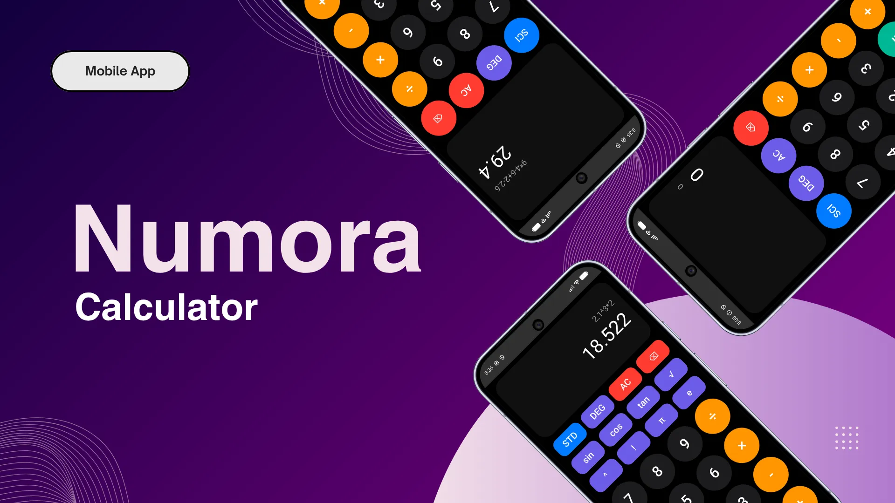
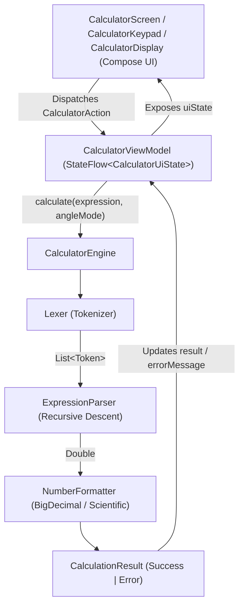
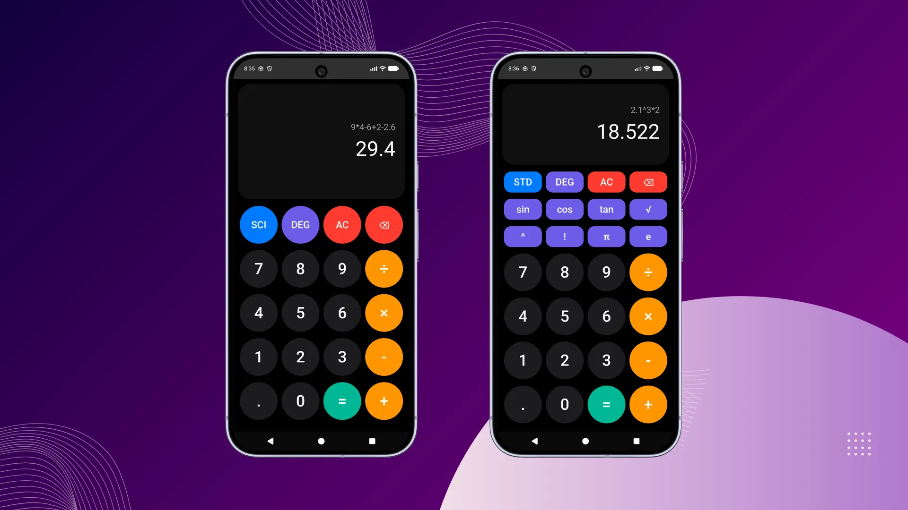

# Numora - Calculator




## Project Overview

Numora - Calculator is a native Android mobile application built with Kotlin and Jetpack Compose that provides both standard arithmetic and scientific calculation capabilities on an AMOLED dark interface. Rather than delegating math evaluation to external script engines or sequential state machines, it implements a deterministic, pure-Kotlin expression pipeline (`Lexer`, recursive-descent `ExpressionParser`, and `NumberFormatter`) to enforce proper operator precedence, implicit multiplication, and clear arithmetic error reporting offline. It is designed for Android users, students, and technical practitioners who want a fast, responsive, distraction-free calculator.

## Key Features

- **Standard & Scientific Keypad Modes**: Toggle dynamically between a compact 4x4 basic arithmetic pad (`SCI`) and an expanded scientific layout (`STD`) with animated vertical transitions (`AnimatedVisibility`).
- **Custom Expression Lexer & Recursive-Descent Parser**: Evaluates multi-term mathematical expressions with full operator precedence (`+`, `-`, `×`, `÷`, unary negation, right-associative `^`, postfix `!` and `%`), parentheses, and implicit multiplication (e.g., `2π` or `2(5)`).
- **Trigonometric & Logarithmic Functions**: Supports `sin`, `cos`, `tan`, `asin`, `acos`, `atan`, base-10 `log`, natural logarithm `ln`, and `sqrt`, alongside `π` and `e` constants.
- **Degree & Radian Angle Mode Switching**: Switch seamlessly between `DEG` and `RAD` modes from the top control bar for trigonometric evaluations.
- **Precision Number Formatting & Domain Validation**: Uses `BigDecimal` scaling (`HALF_UP` rounding up to 12 decimal places, stripping trailing zeros) and scientific notation for extreme magnitudes, while catching division by zero, negative square roots, undefined tangents, invalid factorials, and overflow errors.
- **Tactile AMOLED Dark UI**: Features pure black (`#000000`) OLED backgrounds, color-coded Material 3 buttons with spring press-scale animations, keyboard-tap haptic feedback, and adaptive display/result font sizing.

## Supported Platforms

| Platform | Operating System | Minimum Version | Support / Test Status |
| :--- | :--- | :--- | :--- |
| Android Mobile | Android (API 26–37) | Android 8.0 Oreo (minSdk 26) | Configured target in `app/build.gradle.kts`; core engine, parser, and ViewModel have JUnit 4 unit tests (on-device UI testing not documented as executed) |

## Tech Stack

| Category | Technology | Purpose |
| :--- | :--- | :--- |
| Language | Kotlin | Application logic, parser engine, UI composables, and Gradle build scripts |
| UI Framework | Jetpack Compose & Material 3 | Declarative AMOLED dark interface, animated keypad visibility, and adaptive typography |
| State Management | AndroidX ViewModel & StateFlow | Unidirectional state flow (`CalculatorUiState`) and sealed action dispatch (`CalculatorAction`) |
| Math & Formatting | Kotlin Math & `java.math.BigDecimal` | Trigonometric/logarithmic evaluation and precision decimal/scientific formatting |
| Build System | Gradle Wrapper & Android Gradle Plugin | Dependency resolution via Version Catalog (`libs.versions.toml`) and APK/AAB packaging |
| Unit & UI Testing | JUnit 4, Kotlinx Coroutines Test, Espresso & Compose UI Test | Engine, parser, and ViewModel unit verification plus Android instrumentation test scaffolding |

## Application Architecture

Numora - Calculator follows a unidirectional MVVM architecture separating the Jetpack Compose presentation layer, ViewModel state management, and a pure-Kotlin mathematical evaluation engine. User interactions in `CalculatorScreen` and `CalculatorKeypad` dispatch sealed `CalculatorAction` events to `CalculatorViewModel`, which updates the immutable `CalculatorUiState` exposed via `StateFlow` and delegates expression evaluation to `CalculatorEngine`. Inside the engine, `Lexer` tokenizes raw input strings into typed `Token` instances, `ExpressionParser` evaluates the grammar via recursive descent respecting `AngleMode`, and `NumberFormatter` normalizes the numeric output into `CalculationResult.Success` or `CalculationResult.Error`.



## Screenshots / Preview

### 1. Standard & Scientific Calculator Interface

Side-by-side preview of Numora - Calculator running in Standard Mode (left) and Scientific Mode (right) on an AMOLED dark theme. Each screen displays a rounded calculation surface with the active expression above the formatted output, a 4-button top control bar (`SCI`/`STD`, `DEG`/`RAD`, `AC`, `⌫`), and color-coded tactile keys; toggling to Scientific Mode smoothly expands two additional function rows for `sin`, `cos`, `tan`, `√`, `^`, `!`, `π`, and `e`.

## Prerequisites

- **Developer Requirements**:
  - Android Studio (compatible with Android Gradle Plugin `9.3.2` and Kotlin `2.2.10`)
  - Java Development Kit (JDK) 11 or newer (configured for `JavaVersion.VERSION_11` compilation)
  - Android SDK Platform 37 (`compileSdk = 37`, `targetSdk = 37`) and Android SDK Build-Tools
  - Android Emulator or physical Android device with USB debugging enabled
- **End-User Requirements**:
  - Android smartphone or tablet running Android 8.0 Oreo (API level 26) or higher

## Installation & Setup

1. Clone the repository to your local machine:
   ```bash
   git clone https://github.com/weztcy/Numora-Calculator.git
   cd "Numora-Calculator"
   ```
2. Open the project in Android Studio or verify your local Android SDK path in `local.properties` (`sdk.dir=...`).
3. Sync Gradle dependencies using the included Gradle Wrapper (version `9.5.0`) via Version Catalog (`gradle/libs.versions.toml`):
   ```bash
   ./gradlew build
   ```
4. Install and launch the debug build onto a connected Android device or running emulator:
   ```bash
   ./gradlew installDebug
   ```

## Application Configuration

Configuration for Numora - Calculator is managed at build and manifest level; no external API keys, environment files, or runtime database setup are required to run the application.

| Configuration | Description | Default / Example |
| :--- | :--- | :--- |
| `applicationId` / `namespace` | Android package identifier configured in `app/build.gradle.kts` | `com.example.calculator` |
| `minSdk` / `targetSdk` / `compileSdk` | Android API level bounds for device compatibility and compilation | `minSdk = 26`, `targetSdk = 37`, `compileSdk = 37` |
| `org.gradle.jvmargs` | JVM heap and encoding flags in `gradle.properties` | `-Xmx2048m -Dfile.encoding=UTF-8` |
| `org.gradle.configuration-cache` | Enables Gradle configuration caching for faster incremental builds | `true` |
| `AngleMode` (Initial State) | Default trigonometric angle unit initialized in `CalculatorUiState` | `AngleMode.DEG` |
| `android:allowBackup` | Android Auto Backup and data extraction rules in `AndroidManifest.xml` | `true` (`@xml/backup_rules`) |

## Testing

The repository includes a JUnit 4 local unit test suite under `app/src/test/java/com/example/calculator/` covering the lexical analyzer, recursive-descent parser, calculation engine error handling, and ViewModel state transitions, alongside AndroidX/Espresso instrumentation test dependencies in `app/build.gradle.kts`.

- `CalculatorEngineTest.kt`: Verifies addition, operator precedence, parentheses override, right-associative exponentiation, factorials, square roots, degree-mode trigonometry, division by zero, and negative square root error handling.
- `ExpressionParserTest.kt`: Validates token parsing for arithmetic operators, unary minus, postfix percentage and factorial, implicit multiplication (`2π`), and `π` constant evaluation.
- `CalculatorViewModelTest.kt`: Tests `CalculatorAction` dispatch (`NumberInput`, `OperatorInput`, `Calculate`, `Clear`, `Backspace`, `ToggleAngleMode`) and error state propagation on `StateFlow<CalculatorUiState>`.
- `ExampleInstrumentedTest.kt`: Provides Android instrumentation test scaffolding (`AndroidJUnitRunner`).

Run the local JVM unit tests via Gradle Wrapper:

```bash
./gradlew testDebugUnitTest
```

## Build & Packaging

Android application packages (APK and Android App Bundle) are built locally through the Gradle Wrapper using the configurations in `app/build.gradle.kts` and `app/src/main/keepRules/rules.keep`. Note that `buildTypes.release` currently sets `optimization { enable = false }`.

1. Generate a debug APK for local device testing:
   ```bash
   ./gradlew assembleDebug
   ```
2. Generate a release APK in `app/build/outputs/apk/release/`:
   ```bash
   ./gradlew assembleRelease
   ```
3. Generate an Android App Bundle (`.aab`) in `app/build/outputs/bundle/release/`:
   ```bash
   ./gradlew bundleRelease
   ```

## Usage

Once installed on an Android device or emulator, Numora - Calculator launches directly into the standard calculator interface with no onboarding or login required.

1. Tap the **Calculator** launcher icon on your Android home screen or app drawer to open `MainActivity`.
2. Enter numbers and standard arithmetic operators (`+`, `-`, `×`, `÷`, `.`) using the circular keypad; tap `=` to evaluate the expression in the upper display card.
3. Tap `SCI` in the top control row to expand the scientific panel (`sin`, `cos`, `tan`, `√`, `^`, `!`, `π`, `e`), or tap `STD` to collapse back to Standard Mode.
4. Tap `DEG` / `RAD` to switch trigonometric angle units before evaluating expressions containing `sin`, `cos`, or `tan`.
5. Use `⌫` to delete the last character in the current expression, or `AC` to clear the expression, result, and any displayed error message.

## Contributing

Contributions are welcome to extend parser capabilities, expand Compose UI test coverage, or refine layout responsiveness. Follow these steps to submit a change:

1. Fork the repository.
2. Create a feature or fix branch (`git checkout -b feature/your-feature`).
3. Implement your changes following the existing Kotlin code style (`kotlin.code.style=official`).
4. Run unit tests (`./gradlew testDebugUnitTest`) to verify parser and ViewModel behavior.
5. Commit and push your branch to your fork.
6. Open a pull request with a clear explanation of the changes.

## License

This project is licensed under the MIT License.
See the [LICENSE](LICENSE) file for details.

## Author & Contact

**Yohanes Dimas Pratama**

- GitHub: [github.com/weztcy](https://github.com/weztcy)
- Portfolio: [yohanesdimas.com](https://yohanesdimas.com)
- LinkedIn: [linkedin.com/in/yohanes-dimas](https://www.linkedin.com/in/yohanes-dimas)
